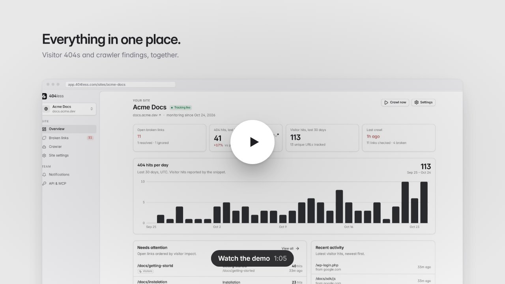
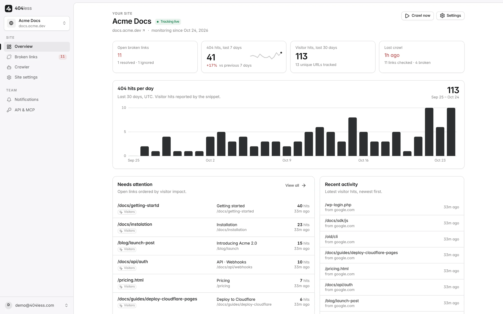
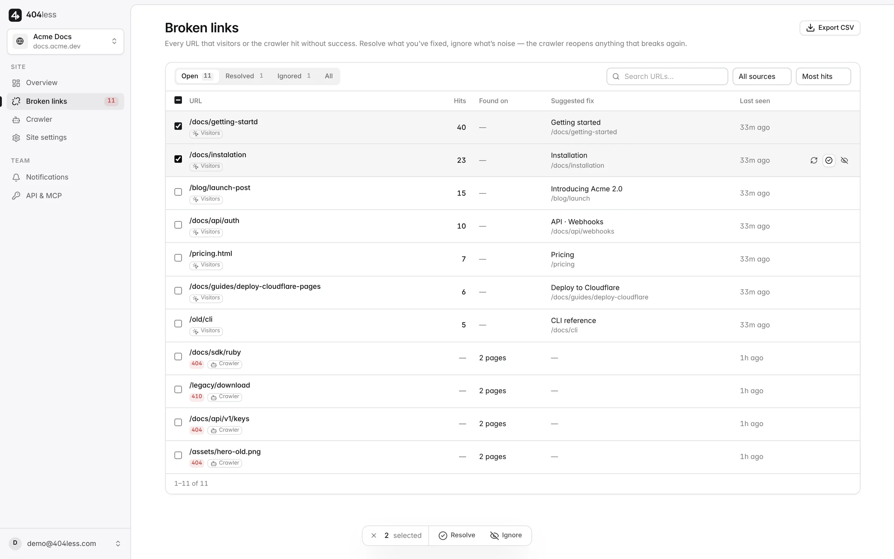
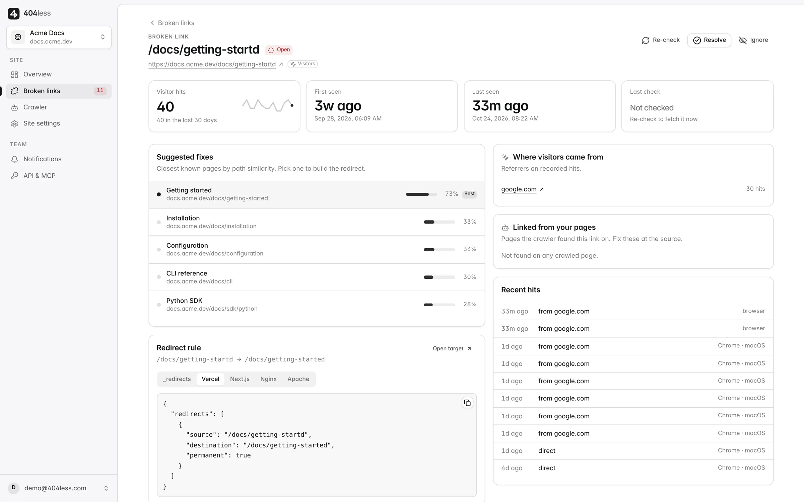
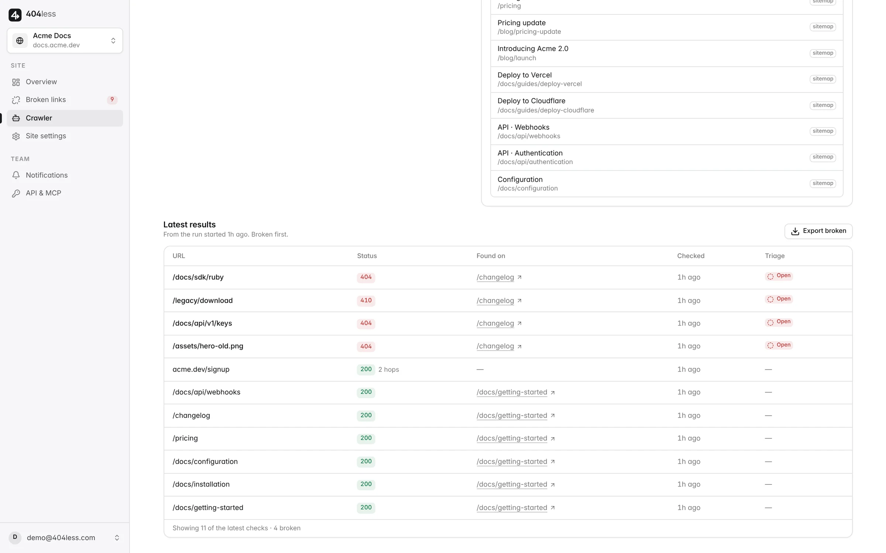
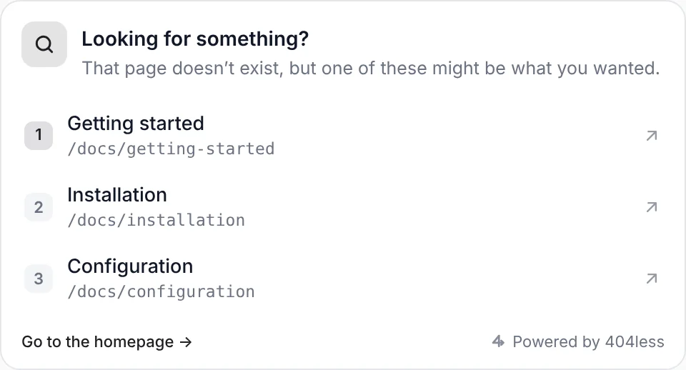

# 404less

Broken links, found and fixed before your visitors give up. Self-hostable on
Cloudflare's free tier.

<p align="center">
  <a href="docs/demo/404less-demo.mp4"></a>
</p>
<p align="center"><sub><b><a href="docs/demo/404less-demo.mp4">▶ Watch the demo</a></b> · 65 seconds, with sound · rendered from the real app by <a href="docs/demo">docs/demo</a></sub></p>

- **Realtime 404 tracking:** one script tag on your 404 page reports every hit
  (URL, referrer) and shows the visitor a "Looking for something?" card with the
  closest matching pages.
- **Scheduled crawler:** fetches your pages, checks every link and asset,
  records redirect chains, respects robots.txt, and re-verifies open broken links
  so they resolve on their own once fixed.
- **One list to manage:** every finding lands in a single broken-links list with
  open / resolved / ignored states, bulk actions, search, CSV export, suggested
  replacements and a copy-paste redirect rule for your platform.
- **Digests, not noise:** Slack, Pushover or email; one grouped digest per
  window per site. Ignored links never alert.
- **MCP for your agent:** read-only tools (`list_sites`, `list_broken_links`,
  `get_link_details`, `get_suggestions`) over streamable HTTP so Claude Code or
  Cursor can open the fix PR. 404less never writes to your repo.

## Screenshots

<p align="center">
  <a href="site/assets/img/overview.webp"></a>
  <a href="site/assets/img/links-sel2.webp"></a>
</p>
<p align="center">
  <a href="site/assets/img/detail-vercel.webp"></a>
  <a href="site/assets/img/crawl-results.webp"></a>
</p>
<p align="center">
  <a href="site/assets/img/widget.webp"></a>
</p>
<p align="center"><sub>Overview · Broken links · Link detail with redirect rule · Crawler results · The widget visitors see on your 404 page</sub></p>

Stack: Cloudflare Workers + D1 + Durable Objects + Cron Triggers, Hono, Drizzle, TypeScript;
React 19 + React Router + TanStack Query SPA served as Worker static assets.
Built on the [groot](https://github.com/AshikNesin/groot) boilerplate (pnpm
workspace: synced `packages/*`, app code in `apps/web`). Design doc:
[docs/DESIGN.md](docs/DESIGN.md).

One Worker serves everything: the marketing site at `/` (`/embed`, `/self-host`,
`/agent`), the dashboard under `/app` (sign-in at `/app/login`), the dashboard API
under `/api/v1`, the snippet at `/embed.js` (with its endpoints `/api/track` and
`/api/suggestions`) and MCP at `/mcp`.

## Quick start (local)

Requires Node 24 and pnpm (`corepack enable`).

```bash
pnpm install
pnpm dev:worker        # builds the SPA + marketing site, runs the Worker (workerd, local D1 + DOs) on :8787
```

Open http://127.0.0.1:8787 (site) or http://127.0.0.1:8787/app (dashboard).
Migrations apply on the first request. Without `RESEND_API_KEY` a local
server (`localhost`) returns the magic sign-in link directly, so no email setup
is needed for development.

For UI work, `pnpm dev` runs the app on Node with Vite HMR (SQLite in
`data/dev.db`; the crawl tick runs in-process every 30 s, alerts are logged
instead of sent); open `/app`. It runs through `portless` (`npm i -g portless`), as in groot.

```bash
pnpm test:worker       # 404less's integration suite inside workerd + local D1, no Cloudflare account needed
pnpm test              # groot's Node suites + the Node runtime check (in-memory SQLite)
pnpm test:client       # client component tests
pnpm typecheck         # server + client
pnpm check             # lint + format
pnpm build:og          # re-render the Open Graph images (needs Playwright; output is committed)
```

## Deploy to Cloudflare

[](https://deploy.workers.cloudflare.com/?url=https://github.com/AshikNesin/404less)

Manual:

```bash
pnpm exec wrangler d1 create 404less          # paste database_id into wrangler.jsonc
pnpm deploy:worker                             # build SPA + site, deploy (migrations apply on the first request)
pnpm exec wrangler secret put RESEND_API_KEY   # required: email sign-in links (+ email digests)
pnpm exec wrangler secret put MAIL_FROM        # optional, e.g. "404less <no-reply@yourdomain>"
```

`RESEND_API_KEY` is the one secret a public deployment needs: without it,
sign-in on a non-local host answers 503 rather than handing sign-in links to
whoever asks. The session secret (and the keys groot's production checks ask
for) are generated on first boot and kept in D1.

Optional vars (`wrangler.jsonc` → `vars`): `MAX_SITES_PER_TEAM` (default 5),
`CRAWL_INTERVAL_HOURS` (default 24: how often a site with scheduled crawling
is crawled), `EVENT_RETENTION_DAYS` (default 90). Crons: the crawl tick every
minute, retention nightly. Everything fits the Workers Free plan at hobby scale.

### How crawling fits the Free plan

There is no Cloudflare Queue. A crawl run's pages to fetch and links to check
are rows in D1 (`crawl_tasks`, one per URL per run, so a link on every page is
checked once), and a cron tick every minute works through them:

- each tick makes at most 40 outbound fetches (the Free plan allows 50 per
  invocation), parses at most 5 pages (Free allows 10 ms of CPU) and stops
  after 40 s; the next tick carries on where it stopped. A tick with nothing
  to do only reads.
- "Crawl now", a sitemap import, and the dashboard's polling while a crawl
  runs each start a tick right away, so a crawl you are watching is quick.
- a run fetches at most the site's "pages per crawl" (default 100), counting
  pages it discovers, and re-crawling an unchanged page rewrites nothing.

A 100-page site with ~300 distinct links costs roughly 400 fetches over
20-odd ticks (about 20 minutes unattended, faster while you watch) and ~4k D1
row writes per run (the first run also records every page's links). Crawling
daily that is a few percent of the Free plan's 100k writes/day;
`CRAWL_INTERVAL_HOURS=6` is still comfortable for a few sites.

Upgrading from a version that used Queues: delete the old queue first
(`pnpm exec wrangler queues delete 404less-crawl`), then deploy. While its
consumer is attached, Cloudflare rejects a Worker without a queue handler
("Queue handler is missing", code 11001).

## Install the snippet

```html
<script src="https://your-404less.example/embed.js" data-site="SITE_KEY" defer></script>
```

Add it to your 404 template. The script detects a 404 page from the title, a
`data-404` attribute on `<html>`/`<body>`, a `prerender-status-code` meta tag, or
`data-404="true"` on the script tag itself. Options via `data-` attributes:

| attribute                 | values                                                         | default         |
| ------------------------- | -------------------------------------------------------------- | --------------- |
| `data-mode`               | `toast` (floating card) · `inline` (render into `data-target`) | `toast`         |
| `data-target`             | CSS selector for inline mode                                   | script's parent |
| `data-theme`              | `auto` · `light` · `dark`                                      | `auto`          |
| `data-accent`             | any CSS color                                                  | indigo          |
| `data-title`, `data-text` | heading / intro copy                                           | none            |
| `data-position`           | `right` · `left` · `center` (desktop toast)                    | `right`         |
| `data-max`                | 1–5 suggestions                                                | 3               |
| `data-track`              | `false` to only show suggestions                               | `true`          |
| `data-branding`           | `false` to hide "Powered by 404less"                           | `true`          |

Styling hooks: `.f404less { --f404-accent; --f404-bg; --f404-fg; --f404-muted; --f404-border; --f404-radius }`.
Site settings → "Preview the widget" opens `/embed-preview.html` with your key.

## API & MCP

Create a key under **API & MCP**, then:

```bash
claude mcp add --transport http 404less https://your-404less.example/mcp \
  --header "Authorization: Bearer 404l_…"
```

The key authenticates MCP; the dashboard API under `/api/v1` uses the signed-in
session cookie (see `apps/web/src/server/api/*/*.routes.ts`).

### MCP over stdio (directory listings)

Glama and similar directories build the root `Dockerfile` and expect a process
that speaks MCP on stdin/stdout. The image runs `apps/web/src/server/mcp-stdio.ts`
(no npm install: Node strips the types). It answers `initialize` and `tools/list`
with the same four read-only tools as `POST /mcp`. It has no database.
`tools/call` forwards to your instance only when both are set:

```bash
docker build -t 404less-mcp .
docker run --rm -i \
  -e F404_MCP_URL=https://your-404less.example/mcp \
  -e F404_API_KEY=404l_… \
  404less-mcp
```

Without those variables, `tools/call` returns an error telling the caller to set
them. `glama.json` names the GitHub maintainer so the listing can be claimed.
On Glama’s Dockerfile admin page, if it asks for build steps rather than using
this Dockerfile, leave the build steps empty and set the command to
`node --experimental-strip-types apps/web/src/server/mcp-stdio.ts`.

## Layout

```
apps/web/
  src/server/              Hono app (app.ts) on @groot/core
    entry.worker.ts        Worker entry: fetch + cron handlers, DO exports
    worker/                boot (migrations, groot bootstrap), cron wrapper, static-assets routing
    api/<feature>/         routes + services: auth (magic link), sites, links (triage model), crawl,
                           channels, keys, sitemap, ingest (widget), mcp, embed, events
    lib/                   session auth, mailer, notify, suggest (ranking), sitemap parsing
    do/                    Durable Objects: per-site alert digest, ingest rate limiter
    db/                    Drizzle schema, cross-driver batch helpers, Node SQLite
    entry.node.ts          Node dev entry (pnpm dev) with in-process binding stand-ins
  src/client/              React SPA (served for /app and /app/*): pages, features, components
  drizzle/                 SQL migrations (0001–0007 predate groot; never rename them)
packages/                  groot boilerplate (core, ui, shell, jobs, ai), synced with `pnpm groot:sync`
site/
  pages/*.html             marketing pages (index, embed, self-host, agent, 404) + layout.html
  partials/waitlist.html   cloud-version form, inserted by <!--waitlist:source-->
  llms.txt                 /llms.txt (copied into the build and listed in sitemap.xml)
  build.mjs                renders pages into dist/client, copies the demo video, writes sitemap.xml + robots.txt
  og/                      Open Graph image template + renderer → site/assets/og/*.png
tests/worker/              404less's integration suites, inside workerd via SELF.fetch()
tests/server/              groot's Node suites (synced) + tests/server/app (404less on Node)
```

## Marketing site

`pnpm build:client` (and `pnpm dev:worker`) renders `site/pages/*.html` through
`site/layout.html` into `dist/client`. The Worker (`worker/static-assets.ts`,
`run_worker_first`) serves `/` and `/embed` as those files, `/app/*` as the SPA,
and anything else as `404.html` with status 404 and `noindex`.

The 404 page loads `/embed.js` with the site key `404less-site`. That key needs
no database row: suggestions are the real ranker over `/`, `/embed`, `/self-host`
and `/agent`, and the hit is appended to the `kv` row `marketing-404:hits` (last
100). Set the Worker var `MARKETING_SITE_KEY` to a real site key to log into
that site’s dashboard instead. Read the demo log with:

```bash
pnpm exec wrangler d1 execute 404less --remote \
  --command "SELECT value FROM kv WHERE key = 'marketing-404:hits'"
```

### Cloud waitlist

The homepage and the self-host page include `site/partials/waitlist.html`
(`<!--waitlist:homepage-->`, `<!--waitlist:self-host-->`). A future tool page
uses the same marker with its own source (`<!--waitlist:redirects-->`, matching
`[a-z0-9-]{1,32}`). The form POSTs to `/api/waitlist`. Signups are rows in `kv`
(`waitlist:<email>` → `{ source, created_at }`). Duplicate emails stay listed
once. A hidden company field and a cross-origin POST are answered `ok` and not
stored. Five signups per IP per hour, then 429. Read them with:

```bash
pnpm exec wrangler d1 execute 404less --remote \
  --command "SELECT key, value FROM kv WHERE substr(key, 1, 9) = 'waitlist:'"
```

D1 is already provisioned by the Deploy button, so the waitlist does not add a
KV namespace or a third-party form host.

### Analytics

Off until you set a Worker var (`.dev.vars` locally, `wrangler secret put` or
`[vars]` for a deploy). Do not commit the value.

- `UMAMI_WEBSITE_ID` — Umami website id. Script defaults to `https://hi.nesin.io/script.js` (`UMAMI_SRC` overrides it).
- `POSTHOG_KEY` — PostHog project key. Host defaults to `https://us.i.posthog.com` (`POSTHOG_HOST` overrides it). Persistence is memory-only (no cookie) and autocapture is off.

`site/assets/site.js` sends events when the matching global exists:

| Event             | When                                                            |
| ----------------- | --------------------------------------------------------------- |
| `waitlist_signup` | the waitlist form succeeds (`source` is homepage, self-host, …) |
| `self_host_click` | a Deploy to Cloudflare link, or a link to `/self-host`          |
| `github_click`    | a link to `github.com/AshikNesin/404less`                       |
| `copy_snippet`    | a Copy button on a code block (`label` is the section id)       |

### Canonical host

`entry.worker.ts` answers `http://…` with 301 to https (308 for other methods)
for any non-local host, and `www.404less.com` with 301 to `https://404less.com`.
It runs only when Cloudflare set `CF-Ray` (every real edge request). `wrangler dev`
does not, and it rewrites `request.url` to the custom domain, so a redirect there
would loop. `localhost` and `127.0.0.1` stay on http even with a ray.
Because the asset cache can answer before the Worker, also turn on
**SSL/TLS → Edge Certificates → Always Use HTTPS** in the Cloudflare dashboard
and purge the cache once after deploy. A checked request on 10 Nov 2026 got
HTTP 200 (the full page, `CF-Cache-Status: HIT`), not a 500; the redirect is
what that response was missing.

### GitHub repository listing

Suggested description:

> Self-hosted 404 tracking and broken-link monitoring on Cloudflare's free tier. Visitor hits, a crawler, suggested fixes, redirect rules, and a read-only MCP server.

Homepage URL: `https://404less.com`

Topics: `broken-links`, `404`, `link-checker`, `cloudflare-workers`, `mcp`, `self-hosted`

These are also `description`, `homepage`, `author` and `keywords` in `package.json`. GitHub’s About settings are separate; set them in the repository UI.

## License

MIT. Copyright (c) 2026 Ashik Nesin / Nesin Technologies. See [LICENSE](./LICENSE).
