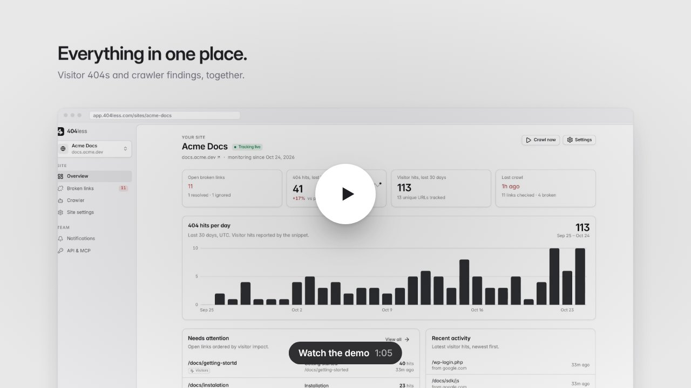
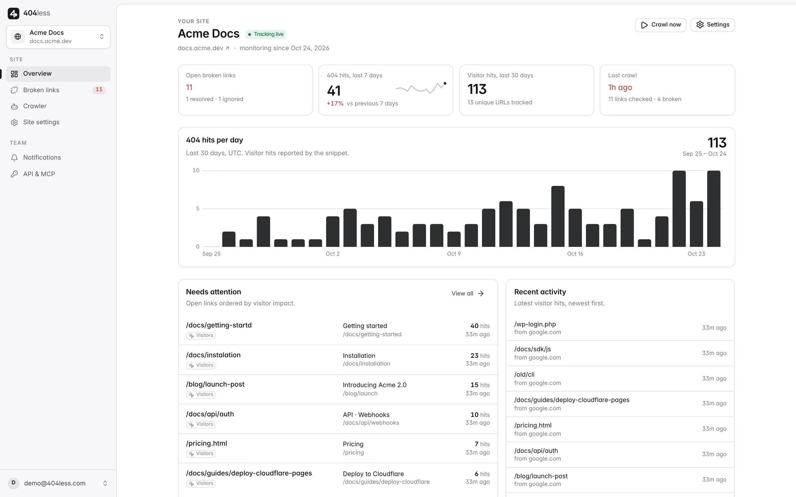
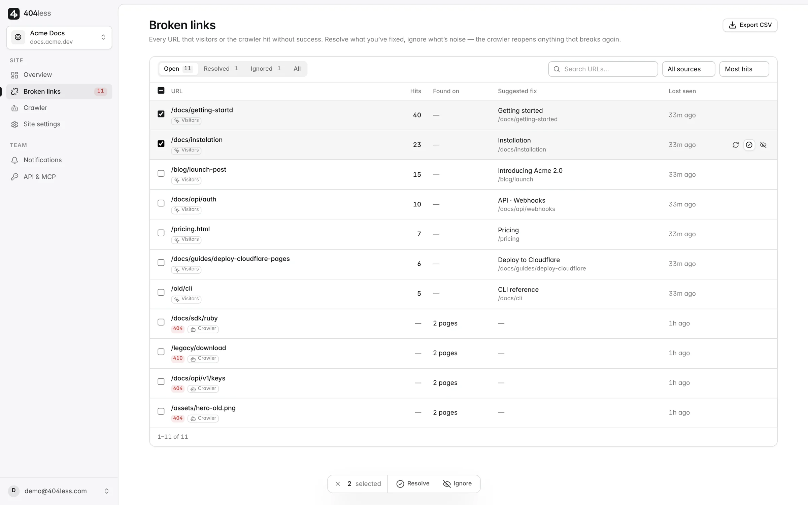
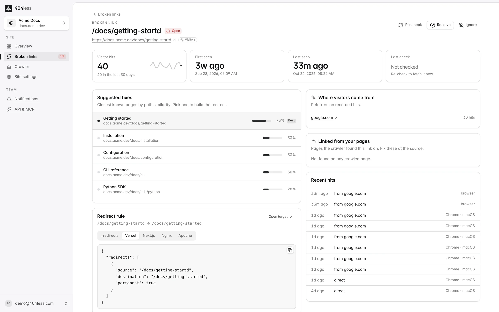
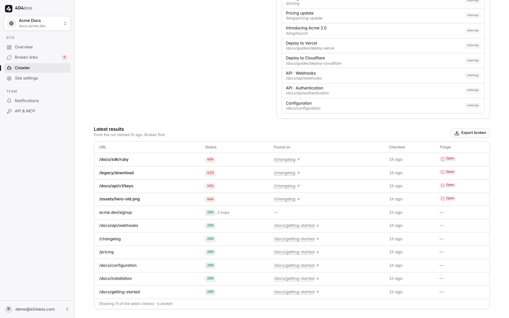
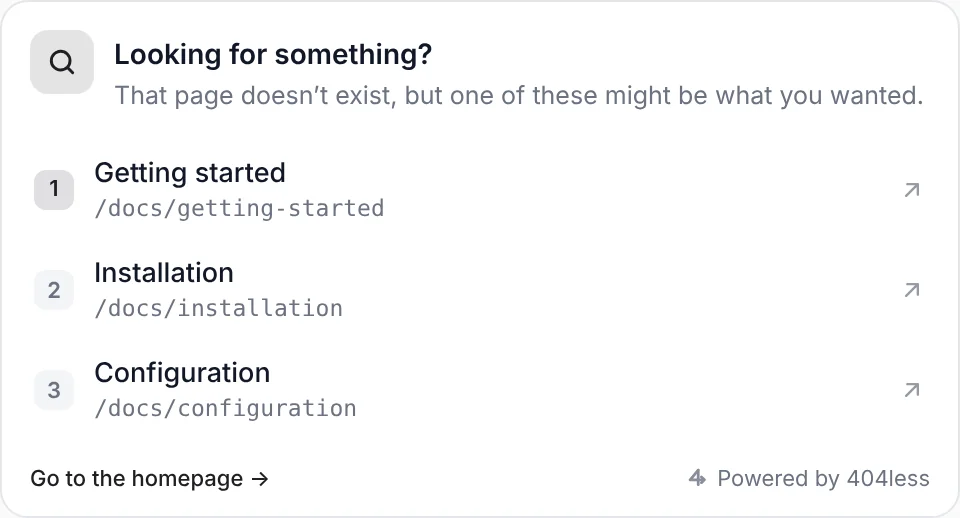

# 404less

Broken links, found and fixed before your visitors give up. Self-hostable on
Cloudflare's free tier.

<p align="center">
  <a href="docs/demo/404less-demo.mp4"></a>
</p>
<p align="center"><sub><b><a href="docs/demo/404less-demo.mp4">▶ Watch the demo</a></b> · 65 seconds, with sound · rendered from the real app by <a href="docs/demo">docs/demo</a></sub></p>

- **Realtime 404 tracking** — one script tag on your 404 page reports every hit
  (URL, referrer) and shows the visitor a "Looking for something?" card with the
  closest matching pages.
- **Scheduled crawler** — fetches your pages, checks every link and asset,
  records redirect chains, respects robots.txt, and re-verifies open broken links
  so they resolve on their own once fixed.
- **One list to manage** — every finding lands in a single broken-links list with
  open / resolved / ignored states, bulk actions, search, CSV export, suggested
  replacements and a copy-paste redirect rule for your platform.
- **Digests, not noise** — Slack, Pushover or email; one grouped digest per
  window per site. Ignored links never alert.
- **MCP for your agent** — read-only tools (`list_sites`, `list_broken_links`,
  `get_link_details`, `get_suggestions`) over streamable HTTP so Claude Code or
  Cursor can open the fix PR. 404less never writes to your repo.

## Screenshots

<p align="center">
  <a href="site/assets/img/overview.webp"></a>
  <a href="site/assets/img/links-sel2.webp"></a>
</p>
<p align="center">
  <a href="site/assets/img/detail-vercel.webp"></a>
  <a href="site/assets/img/crawl-results.webp"></a>
</p>
<p align="center">
  <a href="site/assets/img/widget.webp"></a>
</p>
<p align="center"><sub>Overview · Broken links · Link detail with redirect rule · Crawler results · The widget visitors see on your 404 page</sub></p>

Stack: Cloudflare Workers + D1 + Queues + Durable Objects, Hono, TypeScript;
Vite + React 19 + TanStack Router/Query SPA served as Worker static assets.
Structure follows [open-seo](https://github.com/every-app/open-seo). Design doc:
[docs/DESIGN.md](docs/DESIGN.md).

One Worker serves everything: the marketing site at `/` (`/embed`, `/self-host`,
`/agent`), the dashboard under `/app` (sign-in at `/app/login`), the API under
`/api`, the snippet at `/embed.js` and MCP at `/mcp`.

## Quick start (local)

```bash
npm install && npm --prefix web install
npm run build:web      # SPA + marketing site → dist/web (served by the Worker)
npm run dev            # applies D1 migrations locally, starts the Worker on :8787
```

Open http://127.0.0.1:8787 (site) or http://127.0.0.1:8787/app (dashboard).
Without `RESEND_API_KEY` the magic-link sign-in
returns the link directly (dev mode), so no email setup is needed. For UI work,
`npm run dev:web` starts Vite on :5173 with `/api`, `/auth` and `/embed.js`
proxied to the Worker.

```bash
npm test               # vitest inside workerd + local D1 — no Cloudflare account needed
npm run typecheck      # Worker types
npm --prefix web run typecheck
npm run build:og       # re-render the Open Graph images (needs Playwright; output is committed)
```

## Deploy to Cloudflare

[](https://deploy.workers.cloudflare.com/?url=https://github.com/AshikNesin/404less)

Manual:

```bash
npx wrangler d1 create 404less          # paste database_id into wrangler.jsonc
npm run deploy                           # build SPA + apply migrations + deploy
npx wrangler secret put RESEND_API_KEY   # email (sign-in links + email digests)
npx wrangler secret put MAIL_FROM        # optional, e.g. "404less <no-reply@yourdomain>"
```

Optional vars (`wrangler.jsonc` → `vars`): `MAX_SITES_PER_TEAM` (default 5),
`EVENT_RETENTION_DAYS` (default 90). Crons: crawler every 30 min, retention
nightly. Everything fits the Workers Free plan at hobby scale.

## Install the snippet

```html
<script src="https://your-404less.example/embed.js" data-site="SITE_KEY" defer></script>
```

Add it to your 404 template. The script detects a 404 page from the title, a
`data-404` attribute on `<html>`/`<body>`, a `prerender-status-code` meta tag, or
`data-404="true"` on the script tag itself. Options via `data-` attributes:

| attribute | values | default |
|---|---|---|
| `data-mode` | `toast` (floating card) · `inline` (render into `data-target`) | `toast` |
| `data-target` | CSS selector for inline mode | script's parent |
| `data-theme` | `auto` · `light` · `dark` | `auto` |
| `data-accent` | any CSS color | indigo |
| `data-title`, `data-text` | heading / intro copy | — |
| `data-position` | `right` · `left` · `center` (desktop toast) | `right` |
| `data-max` | 1–5 suggestions | 3 |
| `data-track` | `false` to only show suggestions | `true` |
| `data-branding` | `false` to hide "Powered by 404less" | `true` |

Styling hooks: `.f404less { --f404-accent; --f404-bg; --f404-fg; --f404-muted; --f404-border; --f404-radius }`.
Site settings → "Preview the widget" opens `/embed-preview.html` with your key.

## API & MCP

Create a key under **API & MCP**, then:

```bash
claude mcp add --transport http 404less https://your-404less.example/mcp \
  --header "Authorization: Bearer 404l_…"
```

The same bearer token works for the REST endpoints under `/api` (sites, links,
overview, CSV exports) — see `src/routes/*.ts`.

## Layout

```
src/
  index.ts                 Worker entry (Hono app, DO exports, cron + queue handlers)
  routes/                  thin HTTP routes: auth, api (me/teams/sites), links, channels, keys, sitemap, ingest, mcp, embed
  server/features/         business logic: links (triage model), sites, crawl, mcp, keys, quota, events
  lib/                     auth, mailer, notify, suggest (ranking), sitemap parsing
  do/digest.ts             per-site alert digest Durable Object
  embed_js.txt             the embed script (served at /embed.js)
migrations/                D1 SQL migrations
web/
  app.html                 SPA shell (served for /app and /app/*)
  src/routes/              TanStack file routes (app shell, login, overview, links, crawl, settings)
  src/features/<feature>/  queries + components per feature
  src/components/ui/       primitives (button, card, table, tabs, charts, …)
site/
  pages/*.html             marketing pages (index, embed, self-host, agent, 404) + layout.html
  build.mjs                renders pages into dist/web, writes sitemap.xml + robots.txt
  og/                      Open Graph image template + renderer → site/assets/og/*.png
test/                      vitest suites running inside workerd via SELF.fetch()
```
